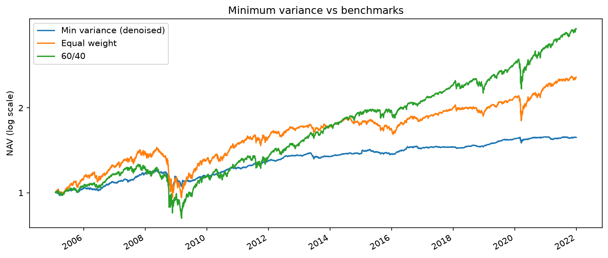
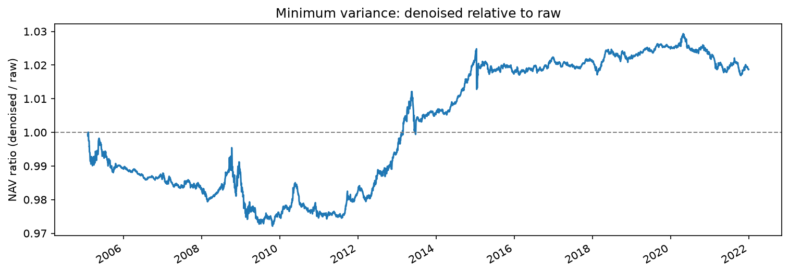
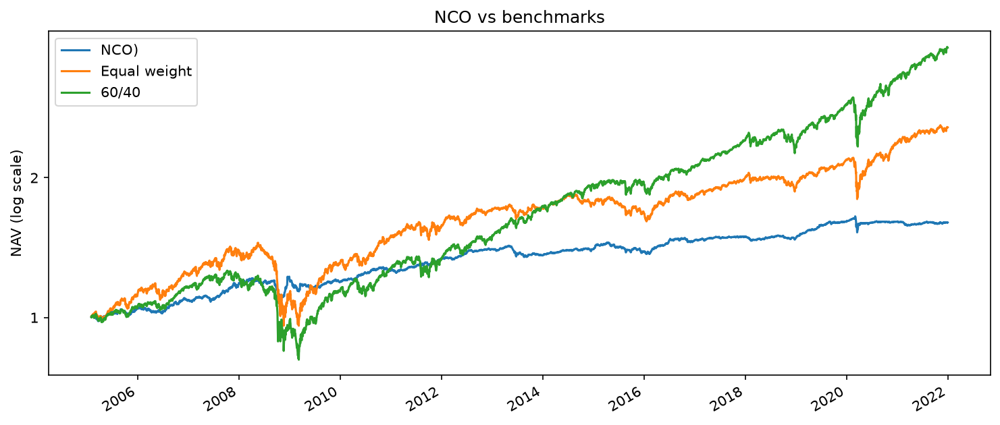

# Allocators L

All strategies are backtested over the research period (2005–2021), net of costs, with monthly rebalancing, as set out in the pre-registration.

## 60/40 (SPY / AGG)
**Role:** benchmark (external reference) 60% S&P 500 (SPY), 40% US aggregate bonds (AGG), rebalanced monthly. 
The traditional balanced portfolio that any allocator should be compared with

## Equal weight
**Role:** benchmark (same universe)
Equal weight across all eligible ETFs (expanding universe, 20% cap). Isolates the value added by any weighting method beyond simply holding the universe

## Risk-weighted (inverse volatility)
**Role:** diagnostic. Added on 2026-10-28, after the benchmark results (see amendment)
Weights proportional to 1 / volatility over the 504-day window, capped at 20%. Shows how much can be gained from volatility alone, ignoring correlations

## Minimum variance: raw and denoised
**Role:** candidates. Added on 2026-11-02
Long-only weights with the lowest portfolio variance, capped at 20%. Uses the full covariance matrix, so it depends on the estimated correlations. Run twice, identical
except for the covariance: sample (min_var_raw) and denoised (min_var_denoised). Method and denoising results: see [methods/denoising.md](methods/denoising.md)

## Hierarchical Risk Parity (HRP)
**Role:** candidate. Added on 03-11-2026
Orders the ETFs by the hierarchical tree of the raw correlation (single linkage), then splits capital top-down: the ordered list is cut in half by count, each half gets a share inversely proportional to its variance, and the split repeats inside each half. No matrix inversion. The 20% cap is applied by the engine. Method: see [methods/clustering.md](methods/clustering.md)

## Nested Clustered Optimisation (NCO)
**Role:** candidate. Added on 04-11-2026
Clusters the ETFs with ONC on the denoised, detoned correlation; runs long-only minimum variance within each cluster on the denoised covariance; treats each cluster as one asset and runs minimum variance across clusters. Final weight = intra-cluster weight × cluster weight. Cap: any ETF above 20% is held at the cap and NCO is re-run on the remaining ETFs, as pro-rata capping inflated near-zero weights (EMLC 0.5% → 20%). Method: see [methods/clustering.md](methods/clustering.md)

## Resuls

### Minimum variance: 2-11-2026
| name             | role       |   ann_return |   ann_vol |   sharpe |   max_drawdown |   avg_turnover |
|:-----------------|:-----------|-------------:|----------:|---------:|---------------:|---------------:|
| sixty_forty      | benchmark  |        0.082 |     0.114 |    0.65  |         -0.357 |          0.022 |
| equal_weights    | benchmark  |        0.057 |     0.1   |    0.492 |         -0.337 |          0.038 |
| risk_weighted    | diagnostic |        0.042 |     0.052 |    0.588 |         -0.194 |          0.035 |
| min_var_raw      | candidate  |        0.026 |     0.034 |    0.438 |         -0.141 |          0.07  |
| min_var_denoised | candidate  |        0.027 |     0.034 |    0.469 |         -0.14  |          0.068 |

**Findings**
- Minimum variance delivers the lowest volatility (3.4%) and drawdown (−14%) of all strategies, but the weakest risk-adjusted return (Sharpe 0.44–0.47)
- It holds up in crises (2008, 2020) and lags in long expansions: level with 60/40 until about 2013, then falls steadily behind
- Its turnover is the highest (about 7% per rebalance, twice equal weight's): the optimiser reshuffles between near-equivalent low-volatility assets
- Risk-weighted, which ignores correlations, beats it on Sharpe (0.59): using the correlations made the portfolio less volatile, but not more efficient
- Denoising moved results in the expected direction (lower turnover, higher Sharpe), but the effect is too small to be meaningful (see methods/denoising.md)

Sharpe differences of less than about 0.25 are within one standard error over 17 years.

### Hierarchical Risk Parity (HRP) 3-11-2026
| name             | role       |   ann_return |   ann_vol |   sharpe |   max_drawdown |   avg_turnover |
|:-----------------|:-----------|-------------:|----------:|---------:|---------------:|---------------:|
| sixty_forty      | benchmark  |        0.082 |     0.114 |    0.65  |         -0.357 |          0.022 |
| equal_weights    | benchmark  |        0.057 |     0.1   |    0.492 |         -0.337 |          0.038 |
| risk_weighted    | diagnostic |        0.042 |     0.052 |    0.588 |         -0.194 |          0.035 |
| min_var_raw      | candidate  |        0.026 |     0.034 |    0.438 |         -0.141 |          0.07  |
| min_var_denoised | candidate  |        0.027 |     0.034 |    0.469 |         -0.14  |          0.068 |
| hrp              | candidate  |        0.031 |     0.038 |    0.532 |         -0.117 |          0.122 |

**Findings**
The turnover of the hrp model is the highest so far. It seems that the structure of the model is working against itself; the tree reorders every month. Single linkage is sensitive: a small change in one correlation can move an ETF to a different branch, which changes the leaf order; bisection is by count, not by branch. When the order shifts, an ETF can land in a different half at the top split, and its weight is multiplied by a very different α. A tiny change in the data becomes a large jump in weight; the cap amplifies it: about 70% of the portfolio gets redistributed every month, in proportions that follow these unstable small weights

### Nested Clustered Optimisation (06-11-2026)
| name             | role       |   ann_return |   ann_vol |   sharpe |   max_drawdown |   avg_turnover |
|:-----------------|:-----------|-------------:|----------:|---------:|---------------:|---------------:|
| sixty_forty      | benchmark  |        0.082 |     0.114 |    0.65  |         -0.357 |          0.022 |
| equal_weights    | benchmark  |        0.057 |     0.1   |    0.492 |         -0.337 |          0.038 |
| risk_weighted    | diagnostic |        0.042 |     0.052 |    0.588 |         -0.194 |          0.035 |
| min_var_raw      | candidate  |        0.026 |     0.034 |    0.438 |         -0.141 |          0.07  |
| min_var_denoised | candidate  |        0.027 |     0.034 |    0.469 |         -0.14  |          0.068 |
| hrp              | candidate  |        0.031 |     0.038 |    0.532 |         -0.117 |          0.122 |
| nco              | candidate  |        0.028 |     0.037 |    0.469 |         -0.097 |          0.083 |

Correlation of daily returns:

|                  | nco  | min_var_denoised | hrp  | risk_weighted |
|:-----------------|-----:|-----------------:|-----:|--------------:|
| nco              | 1.00 | 0.88             | 0.91 | 0.62          |
| min_var_denoised | 0.88 | 1.00             | 0.88 | 0.79          |
| hrp              | 0.91 | 0.88             | 1.00 | 0.73          |
| risk_weighted    | 0.62 | 0.79             | 0.73 | 1.00          |

**Findings**
- NCO behaves much like plain minimum variance, with a similar Sharpe (0.47) and volatility (3.7%), but with the lowest drawdown of all strategies (−9.7% vs −14.0%).
  A plausible explanation, not tested here, is that splitting the universe into two clusters limits how much the optimiser can concentrate in whatever looked safest just before a sell-off
- Its turnover (8.3%) is higher than minimum variance's, so the expected gain in stability did not materialise: ONC re-clustering each month moves the weights
- Its daily returns are closest to HRP's (0.91): the two clustering-based methods converge on similar defensive portfolios
- The three candidates form one defensive family (0.88–0.91); risk-weighted, the only allocator holding meaningful equity risk, is the outlier. They differ in drawdown (NCO −9.7%, HRP −11.7%, min_var −14.0%) and turnover, not in risk-adjusted return

### Conclusions
The hypothesis was that denoised, cluster-based allocation (NCO, HRP) beats equal weight and 60/40 on net Sharpe. On the research period it is not supported: no candidate beats 60/40 (0.65), only HRP beats equal weight (0.53 vs 0.49, within one standard error), and the simple risk-weighted diagnostic (0.59) beats all three. What the candidates deliver is
much lower risk: volatility 3.4–3.8% vs 10–11%, drawdown −10% to −14% vs −34% to −36%. The formal test is on the holdout period. The only reservation I have is that all Sharpes are tightly packed together and as such are statistically indistinguishable, as per the standard error of roughly 0.25.

## Future work (min_var_backtested.ipynb)
Each allocator performs best in a different environment: minimum variance in crises (2008, 2020), equity-heavy allocations in long expansions. A natural extension is a second model that identifies the current regime and chooses the allocator accordingly (regime switching; related to meta-labelling in López de Prado, *Advances in Financial
Machine Learning*). It is outside the pre-registered scope: the regime would have to be detected in real time, not in hindsight, and every regime–allocator combination would count as an additional trial for the Deflated Sharpe Ratio